# OpenSpec Design Component & Quality Gates Strengthening Plan

## Goal Description

Strengthen the DELTA project's OpenSpec workflow (`explore -> propose -> apply -> archive`) so that
UI changes are governed by a clear chain of design authority, approved feature-level hand-off,
implementation requirements, and verifiable quality gates.

The governance model is:

**DELTA Design System -> Feature Prototype -> OpenSpec Specification -> Production Implementation -> Verification Evidence**

The three repositories have distinct responsibilities:

1. **DELTA Design System**: [`unisdr/delta-design`](https://github.com/unisdr/delta-design) is the
   authoritative source for design tokens, reusable components, accessibility requirements,
   interaction conventions, visual standards, and approved frontend patterns. Local copies of
   `DESIGN.md`, `tokens.json`, and `tokens.css` are manually synced into the DELTA repository from a
   pinned tag/commit of `unisdr/delta-design`.
2. **DELTA Feature Prototypes**: [`unisdr/delta-feature-prototypes`](https://github.com/unisdr/delta-feature-prototypes)
   is the design-to-development hand-off layer. It contains feature-specific prototypes that
   demonstrate the approved application of the DELTA Design System.
3. **DELTA application repository**: The production implementation. OpenSpec defines the
   implementation contract and the quality gates verify conformance to the applicable design-system
   reference and approved feature prototype.

## Review of Previous OpenSpec Implementation & Gaps Resolved

### Design authority and traceability

- Identified `unisdr/delta-design` as the authoritative design-system repository.
- Required UI specifications (`design.md`) to record an immutable design-system release tag and
  commit SHA.
- Required a link (`path` + immutable `commit` SHA) to an approved feature prototype in
  `unisdr/delta-feature-prototypes` whenever a UI change materially affects presentation or
  interaction.
- Added an explicit prototype-approval gate (`feature-prototype.status: required -> approved`)
  enforced via `yarn check:design-system --verify-spec` before implementation begins.

### OpenSpec schema rules

- Updated `openspec/config.yaml` to define the target UI stack: React Aria Components, Tailwind CSS
  v4, Lucide React, Recharts, semantic design tokens, and WCAG 2.2 Level AA.
- Extended `rules.design` to require design-system and prototype traceability metadata and a
  comprehensive content, state, responsive, accessibility, keyboard, and copy checklist.
- Distinguished clearly between:
  - `react-aria`: new or migrated React Aria UI;
  - `legacy-exempt`: legacy-only bug fixes on unmigrated `dts-*` or PrimeReact screens;
  - `non-visual`: backend-only or non-visual changes for which a feature prototype is not required.

### Verification gates

- Split Gate 9 into three explicit sub-checks:
  - **Gate 9a**: Static design-system and token compliance (`scripts/check-design-system.ts` +
    `.github/skills/design-system-check/SKILL.md`);
  - **Gate 9b**: Automated WCAG 2.2 Level AA checks (`@axe-core/playwright` via
    `tests/e2e/helpers/a11y.ts`) and keyboard interaction verification;
  - **Gate 9c**: Feature hand-off parity (`tests/e2e/helpers/prototype-evidence.ts` capturing
    screenshots into gitignored `test-results/gate-9/<name>/` and committing the structured report
    at `openspec/changes/<name>/evidence/gate-9-report.md`, audited by a fresh subagent).
- Updated `.github/skills/anti-pattern-check/SKILL.md` and `.github/skills/code-review/SKILL.md` to
  detect DELTA Design System, prototype-parity, and WCAG 2.2 AA violations.

## Governance Decisions

### 1. Design-system source of truth

`unisdr/delta-design` is the authoritative source for:

- semantic tokens and token usage;
- reusable UI components and visual patterns;
- typography, spacing, layout, iconography, and chart conventions;
- interaction behaviour;
- accessibility requirements;
- approved frontend technologies and implementation guidance.

Each UI-related OpenSpec change MUST record an immutable design-system reference (release tag and
commit SHA). A moving branch such as `main` may be included as a convenience link but MUST NOT be
the sole compliance reference. `DESIGN.md`, `tokens.json`, and `tokens.css` are manually synced into
the application repository as needed.

### 2. Feature-prototype hand-off

`unisdr/delta-feature-prototypes` is the authoritative feature-level design hand-off repository.

A feature prototype SHOULD define or demonstrate, where applicable:

- layout and information hierarchy;
- field, column, and action order;
- navigation and user flow;
- empty, loading, error, success, and delete-confirmation states;
- responsive behaviour;
- validation and interaction behaviour;
- approved application of design-system components;
- content and copy expectations;
- accessibility-relevant interaction intent.

The prototype MUST be referenced by repository path and immutable commit SHA or release tag.

### 3. Prototype applicability

A feature prototype is required for new or materially changed presentation or interaction behaviour.

A change MAY declare `feature-prototype.status: not-required` only when it is:

- backend-only;
- non-visual and does not change user interaction;
- a trivial copy correction;
- an approved legacy-only bug fix on an unmigrated screen; or
- another explicitly justified exception approved during human specification review.

The reason MUST be recorded in `feature-prototype.exception-reason` in `design.md`.

### 4. Conformance standard

Gate 9 MUST assess **functional, structural, state, interaction, accessibility, and visual-intent
parity**, not literal pixel-perfect equality.

Permitted implementation differences include those required by:

- React Aria semantics or behaviour;
- WCAG 2.2 AA compliance;
- responsive layouts;
- browser rendering differences;
- production data constraints;
- supported localisation;
- security or performance requirements.

Material divergence from an approved prototype MUST be documented and approved rather than silently
implemented.

## Updated Workflow and Gate Architecture

```mermaid
flowchart LR
    E["/opsx:explore"] --> P["/opsx:propose"]
    P --> DS["Design-system reference check"]
    DS --> FP["Feature prototype or justified not-required status"]
    FP --> R1["Human specification and prototype approval"]
    R1 --> A["/opsx:apply"]
    A --> G18["Gates 1-8"]
    G18 --> G9A["Gate 9a: Design-system and token compliance"]
    G9A --> G9B["Gate 9b: Accessibility and keyboard compliance"]
    G9B --> G9C["Gate 9c: Feature hand-off parity"]
    G9C --> G10["Gate 10: Second-opinion review, if supported"]
    G10 --> R2["Human diff and evidence review"]
    R2 --> AR["/opsx:archive"]
```

## Implemented Changes

1. **`openspec/config.yaml`**: Added UI Design Authority context, `design.md` traceability rules,
   and Gate 9a/9b/9c task rules.
2. **`.github/agents/spec-writer.agent.md`**: Enforced UI classification (`react-aria`,
   `legacy-exempt`, `non-visual`), immutable references to `unisdr/delta-design` and
   `unisdr/delta-feature-prototypes`, initial `feature-prototype.status: required` gating, and full
   state/accessibility/responsive specification rules.
3. **`.github/agents/sdd-implementer.agent.md`**: Added the Pre-Flight Design & Prototype Approval
   Gate (`yarn check:design-system --verify-spec`), deviation approval rules, and Gate 9a/9b/9c
   execution with fresh-subagent audit and evidence report retention.
4. **`.github/skills/design-system-check/SKILL.md`**: Created the comprehensive static and review
   checklist for tokens/CSS, React Aria components, WCAG 2.2 AA, Recharts, content/copy, and
   feature-prototype intent parity.
5. **`.github/skills/anti-pattern-check/SKILL.md` & `.github/skills/code-review/SKILL.md`**: Added
   UI/design-system anti-patterns and the presentation diff review checklist.
6. **`_docs/workflows/openspec.md` & `.github/copilot-instructions.md`**: Documented the
   three-repository governance model, the three coexisting UI tiers, human review checklists, and
   Gate 9 sub-checks.
7. **`openspec/specs/design-system-components/spec.md`**: Framed the existing Phase 6a/6h `dts-*`
   requirements as a transitional baseline while requiring new or re-skinned components to target
   pinned `unisdr/delta-design` references.
8. **Automated Gate 9 Tooling**:
   - `scripts/check-design-system.ts` (`yarn check:design-system`): diff- and change-aware static
     checker and `--verify-spec` pre-flight validator with narrow inline suppression support.
   - `tests/e2e/helpers/a11y.ts`: Playwright + `@axe-core/playwright` WCAG 2.2 AA helper with
     optional legacy-chrome scoping and structured exception metadata validation, plus keyboard
     focus/target-size helpers.
   - `tests/e2e/helpers/prototype-evidence.ts`: Responsive and material-state screenshot capture
     helper writing PNGs to `test-results/gate-9/<change-name>/` and generating structured markdown
     evidence tables for `openspec/changes/<change-name>/evidence/gate-9-report.md`.
