# Spec-Driven Development with OpenSpec

DELTA uses [OpenSpec](https://github.com/Fission-AI/OpenSpec) to ensure every non-trivial change is
specified before it is implemented. This keeps AI-assisted development predictable across different
tools and models — the spec, not the chat history, is the source of truth.

## First-time setup

OpenSpec is a global CLI tool. Install it once per machine:

```bash
npm install -g @fission-ai/openspec@latest
```

The project is already initialised (`openspec/` directory exists). No `openspec init` needed after
cloning.

## UI Design Governance & Three-Repository Model

For any change affecting UI presentation or user interaction, OpenSpec enforces a clear chain of
design authority:

**DELTA Design System -> Feature Prototype -> OpenSpec Specification -> Production Implementation -> Verification Evidence**

The three repositories have distinct responsibilities:

1. **DELTA Design System ([`unisdr/delta-design`](https://github.com/unisdr/delta-design))**:
   The authoritative source for semantic design tokens, reusable UI components, typography,
   spacing, layout, iconography, chart conventions, interaction behaviour, accessibility
   requirements (WCAG 2.2 Level AA), and approved frontend patterns (React Aria Components,
   Tailwind CSS v4, Lucide React, Recharts).
   - Local copies of `DESIGN.md`, `tokens.json`, and `tokens.css` are manually synced into this
     repository from a pinned `unisdr/delta-design` release tag and commit SHA.
2. **DELTA Feature Prototypes ([`unisdr/delta-feature-prototypes`](https://github.com/unisdr/delta-feature-prototypes))**:
   The authoritative feature-level design-to-development hand-off repository. Feature prototypes
   demonstrate the approved application of the DELTA Design System (layout and information
   hierarchy, field/column/action order, user flow, empty/loading/error/success/delete-confirmation
   states, responsive behaviour, validation, copy expectations, and accessibility intent).
   - Prototypes represent **approved design intent**, not generated production code to copy verbatim.
3. **DELTA Application Repository (this repo)**:
   The production implementation. OpenSpec defines the implementation contract in `design.md` and
   `specs/`, and Quality Gate 9 (`9a`, `9b`, `9c`) verifies conformance to the pinned
   design-system reference and approved feature prototype.

### Why immutable tag or commit pinning is required

Every UI-related OpenSpec change MUST record an immutable design-system reference (release tag and
commit SHA) and, when applicable, an immutable feature-prototype reference (repository path and
commit SHA or release tag) in `design.md`. A moving branch such as `main` may be included as a
convenience link in prose, but MUST NOT be the sole compliance reference — pinning ensures that
design reviews, implementation, and archived verification evidence remain reproducible even as
`unisdr/delta-design` and `unisdr/delta-feature-prototypes` evolve.

### Feature prototype applicability and exceptions

A feature prototype in `unisdr/delta-feature-prototypes` is required for new or materially changed
presentation or interaction behaviour.

A change MAY declare `feature-prototype.status: not-required` only when it is:

- backend-only;
- non-visual and does not change user interaction;
- a trivial copy correction;
- an approved legacy-only bug fix on an unmigrated screen (`ui-classification: legacy-exempt`); or
- another explicitly justified exception approved during human specification review.

The justification MUST be recorded in `feature-prototype.exception-reason` inside `design.md`.

## The workflow

Every change follows these steps:

```mermaid
flowchart LR
    E["/opsx:explore"] --> P["/opsx:propose"]
    P --> DS["Design-system reference check"]
    DS --> FP["Feature prototype or justified not-required status"]
    FP --> R1["Human specification and prototype approval"]
    R1 --> A["/opsx:apply"]
    A --> G18["Gates 1-8"]
    G18 --> G9A["Gate 9a: Design-system and token compliance"]
    G9A --> G9B["Gate 9b: Accessibility and keyboard compliance"]
    G9B --> G9C["Gate 9c: Feature hand-off parity"]
    G9C --> G10["Gate 10: Second-opinion review, if supported"]
    G10 --> R2["Human diff and evidence review"]
    R2 --> AR["/opsx:archive"]
```



```
0. /opsx:explore  →  (optional) clarify a vague intent and identify design-system guidance
                      and existing feature prototypes before proposing
1. /opsx:propose  →  spec artifacts generated in openspec/changes/<name>/
2. Review         →  human reviews proposal.md, specs/, design.md, tasks.md and approves
                      the feature prototype hand-off (status: required → approved)
3. /opsx:apply    →  implementation (TDD: Red → Green → Refactor, incl. Gates 1–8,
                      Gate 9a/9b/9c with verification evidence, and Gate 10 on Claude Code) —
                      stops before archive
4. Review         →  human reviews the diff and Gate 9 evidence — the final checkpoint,
                      after every automated gate and code review has already run
5. /opsx:archive  →  merges specs, moves the change (and evidence/) to openspec/changes/archive/
6. Raise PR       →  archived artifacts and evidence report travel on the branch
```

Never skip a review step. The spec and prototype approval gate are real checkpoints, not
formalities — and neither is the final diff and evidence review: it comes _after_ every applicable
automated review resolves its findings, not before.

## Step 0 — Explore (optional)

Use this when the intent is vague, the problem space is ambiguous, or you need to compare
approaches or locate design-system/prototype references before committing to a proposal.

```
/opsx:explore "I think there's a performance issue in the analytics queries"
```

Explore is a thinking-partner mode — it investigateswhether the change affects presentation or
interaction, identifies relevant `unisdr/delta-design` guidance and existing prototypes in
`unisdr/delta-feature-prototypes`, and clarifies requirements without generating implementation
artifacts. Once the intent is clear, proceed to propose.

Skip this step when the intent is already well-understood.

## Step 1 — Propose

Describe your intent to your AI assistant and invoke:

```
/opsx:propose "fix deleteByIdForStringId to await the select and throw on not-found"
```

The `spec-writer` agent picks this up. It first runs **Phase 0** — reading the actual source files
to validate the intent is still needed and hasn't already been resolved, and classifying the change
as `react-aria`, `legacy-exempt`, or `non-visual`. If the change is confirmed necessary, it
generates:

| Artifact      | Purpose                                                                                                 |
| ------------- | ------------------------------------------------------------------------------------------------------- |
| `proposal.md` | What, why, files affected, test approach, UI classification                                             |
| `specs/`      | Given/When/Then scenarios (observable behaviour, UI states, responsive & accessibility criteria)        |
| `design.md`   | Types, Drizzle schema changes, test infrastructure, pinned design-system & feature-prototype references |
| `tasks.md`    | Ordered implementation checklist (TDD sequence + Gates 1–10 including Gate 9a, 9b, 9c for UI changes)   |

For UI changes, `design.md` records:

```yaml
design-system:
  repository: https://github.com/unisdr/delta-design
  version-or-tag: <release-tag>
  commit: <commit-sha>

feature-prototype:
  repository: https://github.com/unisdr/delta-feature-prototypes
  path: <feature-path>
  commit: <commit-sha>
  status: required | approved | not-required
  exception-reason: <required when not-required>

ui-classification: react-aria | legacy-exempt | non-visual
```

When a prototype is required, `spec-writer` sets `feature-prototype.status: required` so that
implementation cannot start until human review approves the hand-off.

**Before handing these to the user:** read every artifact yourself. A subagent's own
completion summary is not verification — form your own judgment on correctness and
consistency with the real schema/codebase first.

## Step 2 — Human Specification and Prototype Approval Review

Read each artifact before running `/opsx:apply`:

- `proposal.md` — does the scope make sense? Are all affected files listed?
- `specs/` — do the scenarios cover both happy path, failure paths, material UI states, and
  accessibility criteria?
- `design.md` — are the TypeScript types correct? Is the right test tier chosen? Are the
  design-system and feature-prototype references pinned and complete?
- `tasks.md` — does the task order follow TDD (failing test first) and include Gate 9a, 9b, and 9c
  for UI changes?

### Human Review Checklist Before `/opsx:apply` (UI Changes)

- [ ] UI classification (`react-aria`, `legacy-exempt`, or `non-visual`) is correct.
- [ ] The design-system release/tag and commit SHA are recorded.
- [ ] The feature-prototype path and immutable reference are recorded, or a valid exception is approved.
- [ ] The prototype covers the required flow and material states.
- [ ] Accessibility and keyboard expectations are stated.
- [ ] Responsive expectations are stated.
- [ ] Acceptance criteria distinguish design-system compliance from prototype parity.
- [ ] Known deviations or unresolved decisions are explicit.
- [ ] The prototype is approved as the design hand-off (`feature-prototype.status: approved` in `design.md`).

Amend the files directly if anything is wrong. When approving a required prototype, set
`feature-prototype.status: approved` in `design.md` (or state approval explicitly when invoking
`/opsx:apply`).

## Step 3 — Apply

```
/opsx:apply
```

The `sdd-implementer` agent first runs the **Pre-Flight Design & Prototype Approval Gate**
(`yarn check:design-system --verify-spec --change "<name>"`) and refuses to begin a
presentation-affecting implementation if the required prototype approval or immutable design-system
reference is missing.

Once pre-flight passes, `sdd-implementer` runs the full TDD loop:

1. **Red phase** — invokes `tdd-test-writer` to write failing Vitest tests from the spec.
   Confirms tests fail specifically because the behaviour doesn't yet exist (not due to import
   errors or setup issues). _(Recommended: verify the failure reason yourself before proceeding.)_
2. **Green phase** — writes the minimum code to make the failing tests pass against the pinned
   design-system and prototype references.
3. **Refactor loop** — runs quality gates in order. If any gate fails, refactors and re-runs
   from that gate. Exits only when every applicable gate passes:

   | Gate | Check                                                                                                                                                                                             |
   | ---- | ------------------------------------------------------------------------------------------------------------------------------------------------------------------------------------------------- |
   | 1    | `yarn vitest run` — tests still green                                                                                                                                                             |
   | 2    | `yarn tsc` — zero TypeScript errors                                                                                                                                                               |
   | 3    | `yarn format:check` — Prettier clean                                                                                                                                                              |
   | 4    | Anti-pattern review — `.github/skills/anti-pattern-check/SKILL.md`                                                                                                                                |
   | 5    | SOLID review — `solid-reviewer` agent (SRP and DIP focus)                                                                                                                                         |
   | 6    | Documentation review — comments explain WHY, not WHAT, and stay as compact as the code's actual complexity allows (full-diff sweep by a fresh subagent)                                           |
   | 7    | Project conventions — `.github/copilot-instructions.md`                                                                                                                                           |
   | 8    | Code review — repo's `code-review` skill, via a fresh subagent (DELTA/DDD/ADR + design-system/prototype/accessibility alignment)                                                                  |
   | 9a   | Design-system and token compliance — `yarn check:design-system --change <name>` + `.github/skills/design-system-check/SKILL.md` against pinned `unisdr/delta-design`                              |
   | 9b   | Accessibility and keyboard compliance — Playwright + `@axe-core/playwright` WCAG 2.2 AA (`tests/e2e/helpers/a11y.ts`) + keyboard interaction checks across affected routes and states             |
   | 9c   | Feature hand-off parity — responsive & state screenshots (`tests/e2e/helpers/prototype-evidence.ts`) + itemised parity report (`openspec/changes/<name>/evidence/gate-9-report.md`) + fresh audit |
   | 10   | Independent second-opinion review, **Claude Code only** — its built-in `code-review high`, via a second fresh subagent. Other tools: use an equivalent platform feature if one exists, else skip. |

   ### Gate 9 Conformance Standard: Intent Parity vs. Pixel-Perfect Comparison

   Gate 9 (`9a`, `9b`, `9c`) assesses **functional, structural, state, interaction, accessibility,
   and visual-intent parity**, NOT literal pixel-perfect equality:
   - **Gate 9a (Design-system and token compliance)**: Authority is the pinned reference in
     `unisdr/delta-design`. Pass criteria: `yarn check:design-system` passes, `.github/skills/design-system-check/SKILL.md`
     passes, and no unapproved token, component, content, or styling violations remain.
   - **Gate 9b (Accessibility and keyboard compliance)**: Authority is WCAG 2.2 Level AA plus the
     pinned DELTA Design System accessibility guidance. Pass criteria: Playwright + axe-core checks
     (`wcag2a`, `wcag2aa`, `wcag21a`, `wcag21aa`, `wcag22aa`) pass for affected routes and states,
     defined keyboard interactions (`Tab`, `Shift+Tab`, `Enter`, `Space`, `Escape`, Arrow keys) and
     focus order/visibility pass, target sizes are at least `24 x 24` CSS px (`32 x 32` preferred
     for icon-only controls), and any approved exception is documented with tracked issue,
     rationale, owner, and remediation date.
   - **Gate 9c (Feature hand-off parity)**: Authority is the approved, pinned artifact in
     `unisdr/delta-feature-prototypes` and the content/interaction checklist in `design.md`.
     Permitted implementation differences include those required by React Aria semantics, WCAG 2.2
     AA compliance, responsive layouts, browser rendering differences, production data constraints,
     supported localisation, or security/performance requirements. Any material divergence from an
     approved prototype MUST be documented in `design.md` and
     `openspec/changes/<name>/evidence/gate-9-report.md` and approved rather than silently
     implemented.
   - **Verification evidence retention**:
     - Committed markdown report: `openspec/changes/<name>/evidence/gate-9-report.md` (records
       pinned SHAs, commands run, Gate 9a/9b outputs, itemised Gate 9c checklist, and approved
       deviations; travels into `openspec/changes/archive/` on archive).
     - Captured screenshots: `test-results/gate-9/<name>/` (gitignored binary PNGs captured via
       `tests/e2e/helpers/prototype-evidence.ts` across principal responsive sizes and material
       states for human review and PR attachment).

   Additionally, any change to a file under `app/domains/**` with real implementation logic
   (domain entities/services, use cases, infrastructure adapters, DTO mappers with real
   conversion logic — not a type-only interface or a trivial re-export) requires a **test
   quality check**: `test-quality-auditor` runs mutation testing (Stryker) scoped to the changed
   files and reports whether the existing tests would actually catch a real regression — not
   just whether they pass. Default this on; a file with no mutable logic just reports zero
   mutants at little cost, which is cheaper than the alternative of skipping a file that looked
   simple but wasn't. See `.github/agents/test-quality-auditor.agent.md`.

   **Gate 6 also requires one full pass over every comment in the change's entire diff** —
   not just the current round's delta — immediately before the final report. A comment can
   accrete length gradually across several refactor rounds without any single round's check
   ever seeing the whole picture; only a full-diff sweep at the end catches that. Compact any
   comment that says in several lines what fits in one, without losing real information. A
   multi-line comment is not itself a defect — keep it when the code it documents is genuinely
   non-trivial (a subtle invariant, an ordering dependency, a workaround whose reasoning
   doesn't fit on one line). There is no fixed line-count limit; the bar is "no shorter without
   losing meaning," not "no longer than N lines."

   **This sweep must be done by a fresh subagent, not by `sdd-implementer` re-reading its own
   comments.** Self-review has already missed real bloat twice — an author reliably finds their
   own explanation reasonable, the same reason Gate 8/9/10 use a fresh reviewer instead of
   self-critique. `sdd-implementer` applies the fresh subagent's suggested compactions itself.

4. **Keep all artifacts in sync** — `proposal.md` and `specs/` are living documents. When a
   design decision changes the scope, files, approach, or scenarios stated in either (different
   routes, different helpers, trimmed scope, parallel-loading constraint discovered), update
   those artifacts at that point — not just at archive time. For each divergence, ask: was the
   adaptation correct? If yes, update the artifact to match. If no, fix the code. Artifacts that
   contradict `design.md` create ambiguity in the archived record and will surface as review
   findings.

5. **Stop for the final human review** — `sdd-implementer` does not archive or raise a PR
   itself. It reports the final state (gates passed, files changed, `gate-9-report.md` summary,
   regression comparison) and stops. This report already reflects every applicable code review's
   resolved findings, so your review of the diff and evidence at this point is the last checkpoint.

## Step 4 — Final Human Review, Archive, and Raise PR

### Human Review Checklist Before `/opsx:archive`

- [ ] Gates 1–8 pass.
- [ ] Gate 9a passes with static-check evidence (`yarn check:design-system` + `design-system-check`).
- [ ] Gate 9b passes with axe-core WCAG 2.2 AA and keyboard evidence.
- [ ] Gate 9c passes with screenshots (`test-results/gate-9/<name>/`) and an itemised parity review
      in `openspec/changes/<name>/evidence/gate-9-report.md`.
- [ ] Deviations are approved and traceable in `design.md` and `gate-9-report.md`.
- [ ] Documentation and specifications reflect the implemented behaviour.
- [ ] Follow-up migration or remediation issues have owners and target dates.

`opsx:archive` is the last commit on the implementation branch, before the PR is raised:

```
/opsx:archive
```

This merges the change's delta specs into `openspec/specs/`, moves the change folder (including
`evidence/gate-9-report.md`) to `openspec/changes/archive/`, and closes the change. No separate
branch needed — the archived artifacts travel with the implementation in the same PR.

After archiving, raise the PR targeting `dev` as normal.

## Agents and skills reference

| File                                           | Role                                                                                         |
| ---------------------------------------------- | -------------------------------------------------------------------------------------------- |
| `.github/agents/spec-writer.agent.md`          | Phase 0 intent validation + OpenSpec proposal generation (incl. UI classification & pinning) |
| `.github/agents/tdd-test-writer.agent.md`      | Writes failing tests (Red phase) — invoked by sdd-implementer                                |
| `.github/agents/sdd-implementer.agent.md`      | Orchestrates Pre-Flight Gate + Red → Green → Refactor (Gates 1–10), stops before archive     |
| `.github/agents/test-writer.agent.md`          | Comprehensive test suites (all tiers, independent of TDD cycle)                              |
| `.github/agents/solid-reviewer.agent.md`       | SOLID design review — invoked by sdd-implementer at gate 5                                   |
| `.github/agents/test-quality-auditor.agent.md` | Mutation testing (Stryker) on changed files — is a test meaningful, not just green           |
| `.github/skills/tdd-cycle/SKILL.md`            | TDD Red→Green→Refactor methodology and DELTA tooling                                         |
| `.github/skills/anti-pattern-check/SKILL.md`   | Gate 4 quality gate checklist — run before every PR                                          |
| `.github/skills/code-review/SKILL.md`          | Gate 8 — DELTA/DDD/ADR/design-system review, run via a fresh subagent                        |
| `.github/skills/design-system-check/SKILL.md`  | Gate 9 (`9a`, `9b`, `9c`) — DELTA Design System, WCAG 2.2 AA, and prototype parity checklist |

## Useful commands

```bash
# List all active changes
openspec list

# Check artifact status for a change
openspec status --change "<name>"

# View apply instructions for a change
openspec instructions apply --change "<name>"

# Pre-flight verification of design.md metadata & prototype approval
yarn check:design-system --verify-spec --change "<name>"

# Static design-system and token compliance check (Gate 9a)
yarn check:design-system --change "<name>"

# Run a single test file
yarn vitest run tests/path/to/file.test.ts

# Run DOM component interaction tests (jsdom)
yarn test:dom

# Full PGlite suite (primary gate)
yarn test:run2

# Playwright E2E accessibility, keyboard, and design-parity checks (Gate 9b / 9c)
yarn test:e2e --grep "a11y|keyboard|design-parity"

# Type check
yarn tsc

# Format check / fix (scoped to changed files)
npx prettier --check <files>

# Coverage (threshold enforced only on app/domains/**)
yarn coverage

# Mutation testing — always scope to the files an intent touched, never the whole repo
yarn mutation -- --mutate "app/domains/hazardous-events/domain/HazardousEvent.ts"
```

## Claude Code hooks

Two hooks in `.claude/settings.json` (personal, gitignored — not shared via git) enforce parts
of this workflow mechanically: a `PostToolUse` prettier check on edited files, and a
`PreToolUse` gate that blocks a direct `openspec archive` CLI call when `tasks.md` still has
unchecked items (the `/opsx:archive` skill's own confirm-to-proceed flow is untouched by this).

## When not to use OpenSpec

- Typo fixes, one-line changes, or changes where the intent is completely unambiguous
- Emergency hotfixes where speed matters more than process

For everything else — especially anything touching models, handlers, auth, or presentation UI — use
the workflow.
